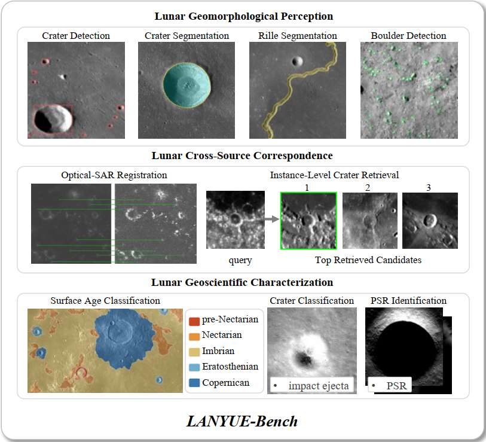

# LANYUE-Bench

LANYUE-Bench comprises 12 downstream datasets for lunar geomorphological
perception, cross-source correspondence and geoscientific characterization.

The seven new datasets are available on [Hugging Face][bench-all]. Each dataset
is distributed as a separate TAR archive.

| Dataset | Samples | Observations | Stored image size | Task | Access |
|---|---:|---|---|---|---|
| ODPLCD | 2,784 | LROC WAC / SLDEM | 593 × 593 | Crater detection | [Original source][odplcd-paper] |
| MSLCD | 8,881 | CE-2 DOM / CE-2 DEM / LROC WAC / NASA DEM | CE-2: 512²; WAC: 48²; NASA DEM: 64² | Crater detection | [Download][mslcd] |
| Moon-Crater-Seg | 6,000 | SLDEM | 256 × 256 | Crater segmentation | [Original source][moon-crater-paper] |
| ODPLCD-Seg | 2,494 | LROC WAC / SLDEM | 593 × 593 | Crater segmentation | [Download][odplcd-seg] |
| lunarRilles | 2,325 | LROC WAC / SLDEM | 512 × 512 | Sinuous rille segmentation | [Original source][rilles-paper] |
| lunarBoulder | 686 | LROC NAC | 500 × 500 | Boulder detection | [Original source][boulder-paper] |
| LunarOSR | 1,750 pairs | CE-2 DOM / Mini-RF | 512 × 512 | Optical–SAR image registration | [Download][lunarosr] |
| LunarICR | 1,200 identities | CE-2 DOM / CE-2 DEM / LROC WAC / SLDEM | 512 × 512 | Cross-source crater retrieval | [Download][lunaricr] |
| LunarSAC | **14,634** | LROC WAC / SLDEM | 512 × 512 | Surface age classification | [Download][lunarsac] |
| LROCNet | 5,000 | LROC NAC | 227 × 227 | Crater classification | [Original source][lrocnet-paper] |
| LunarSCC | 600 | Mini-RF CPR | 224 × 224 | Crater model-age group classification | [Download][lunarscc] |
| LunarPSRC | 406 | CE-2 DOM / LROC WAC | 512 × 512 | Permanently shadowed region identification | [Download][lunarpsrc] |

Sample counts refer to the versions used in LANYUE-Bench. Registration counts
image pairs; retrieval counts crater identities.

Public datasets are linked to their original data releases or publications.

<!-- Published dataset downloads. -->
[bench-all]: https://huggingface.co/datasets/LLukaoo/LANYUE-bench
[mslcd]: https://huggingface.co/datasets/LLukaoo/LANYUE-bench/resolve/main/archives/MSLCD.tar?download=true
[odplcd-seg]: https://huggingface.co/datasets/LLukaoo/LANYUE-bench/resolve/main/archives/ODPLCD-Seg.tar?download=true
[lunarosr]: https://huggingface.co/datasets/LLukaoo/LANYUE-bench/resolve/main/archives/LunarOSR.tar?download=true
[lunaricr]: https://huggingface.co/datasets/LLukaoo/LANYUE-bench/resolve/main/archives/LunarICR.tar?download=true
[lunarsac]: https://huggingface.co/datasets/LLukaoo/LANYUE-bench/resolve/main/archives/LunarSAC.tar?download=true
[lunarscc]: https://huggingface.co/datasets/LLukaoo/LANYUE-bench/resolve/main/archives/LunarSCC.tar?download=true
[lunarpsrc]: https://huggingface.co/datasets/LLukaoo/LANYUE-bench/resolve/main/archives/LunarPSRC.tar?download=true

<!-- Original dataset and publication sources. -->
[odplcd-paper]: https://www.nssdc.ac.cn/nssdc_zh/html/siteinfo.html?439d18ee-a8a8-4feb-86c9-39db28b15fd5
[moon-crater-paper]: https://zenodo.org/records/5563001
[rilles-paper]: https://www.mdpi.com/2072-4292/16/9/1602
[boulder-paper]: https://zenodo.org/records/8171052
[lrocnet-paper]: https://zenodo.org/records/7041842
