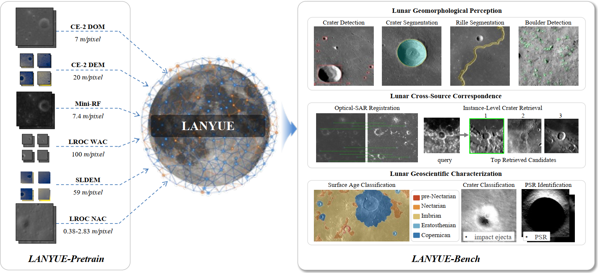
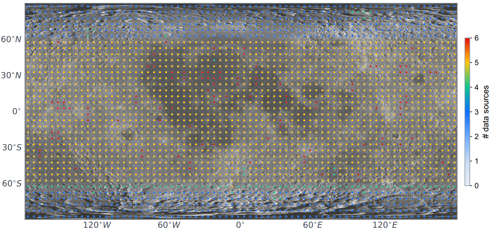
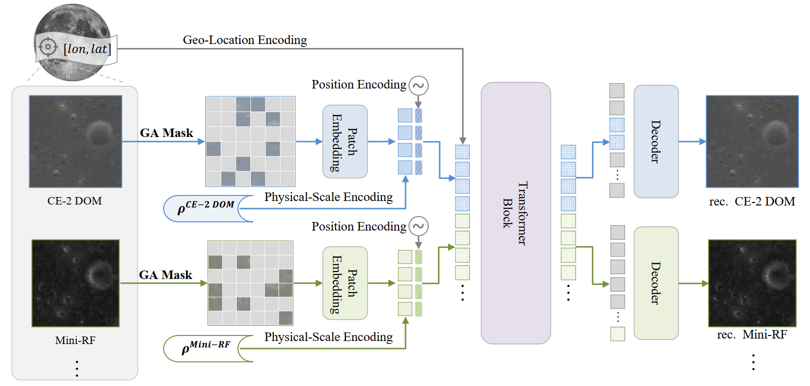

# LANYUE: A Lunar Foundation Model for Unified Representation Learning

LANYUE learns transferable representations from heterogeneous lunar observations
to support lunar science and exploration. This repository provides the model
implementation, pretrained weights and the LANYUE-Bench dataset catalogue.

[Model code](LANYUE/) · [Pretrained weights](https://huggingface.co/LLukaoo/LANYUE) ·
[Benchmark](LANYUE-Bench/) · [Benchmark downloads](https://huggingface.co/datasets/LLukaoo/LANYUE-bench)



## Key features

- 🌕 **Multisource lunar pretraining:** approximately 3.29 million samples from
  six observation sources, covering optical imagery, elevation and SAR at
  0.38–100 m/pixel.
- 🤖 **LANYUE:** a shared HiViT encoder with geology-aware masking,
  physical-scale encoding and spherical geolocation encoding. NAC distillation
  extends the model to high-resolution observations.
- 📊 **LANYUE-Bench:** 12 downstream datasets across three task groups,
  including seven newly constructed datasets available on Hugging Face.

## Pretraining data

LANYUE-Pretrain combines CE-2 DOM, CE-2 DEM, LROC WAC, SLDEM, Mini-RF and
LROC NAC. CE-2 DOM anchors 3,106,648 multisource samples; an additional
182,220 independent NAC samples provide native-resolution imagery. Together,
these give 3,288,868 samples, as reported in the manuscript. Observations from
the same footprint can have different spatial scales and missing modalities.



Data preparation
utilities are included in the model's [preprocessing directory](LANYUE/preprocessing/).

## LANYUE

LANYUE uses modality-specific patch embeddings and a shared hierarchical
Transformer to encode optical, elevation and radar observations. Geology-aware
masking guides reconstruction of sparse geomorphological structures.
Physical-scale encoding captures differences in spatial resolution, while
spherical geolocation encoding provides geographic context. A subsequent
frozen-teacher distillation stage introduces LROC NAC observations.



**Pretrained weights:** [Hugging Face](https://huggingface.co/LLukaoo/LANYUE) ·
[Download LANYUE-HiViT-Base](https://huggingface.co/LLukaoo/LANYUE/resolve/main/lanyue-hivit-base.pth?download=true).

The released checkpoint supports all six modalities and includes its matching
model configuration and normalization statistics. Feature extraction accepts
any available subset of the supported modalities, including NAC alone.

**Further details:** [model installation, feature extraction and training](LANYUE/README.md).

### Quick start

Clone the repository and install the model dependencies with a compatible
PyTorch/CUDA environment:

```bash
git clone https://github.com/LLuKaoo/LANYUE.git
cd LANYUE/LANYUE
python -m pip install -r requirements.txt
python -m pip install huggingface_hub
```

Run the following from the model directory:

```python
import torch
from huggingface_hub import hf_hub_download
from lanyue.models import lanyue_nac
from lanyue.features import encode_features

path = hf_hub_download("LLukaoo/LANYUE", "lanyue-hivit-base.pth")
checkpoint = torch.load(path, map_location="cpu", weights_only=True)
model = lanyue_nac(**checkpoint["config"]["model"])
model.load_state_dict(checkpoint["model"], strict=True)
model.eval()

# Illustrative normalized inputs; replace with preprocessed observations.
inputs = {
    "nasa_dom": torch.randn(1, 1, 48, 88),
    "nasa_dem": torch.randn(1, 1, 80, 144),
}
with torch.no_grad():
    tokens = encode_features(model, inputs)
    descriptor = torch.cat([x.mean(1) for x in tokens.values()], dim=-1)
print(descriptor.shape)  # torch.Size([1, 1024])
```

Inputs must be normalized `[B, 1, H, W]` tensors. The model does not automatically
normalize or resize images. For matching source imagery, use the checkpoint's
preprocessing statistics; use the task's preprocessing when reproducing
downstream experiments. Task-specific prediction heads are trained separately.

## LANYUE-Bench

LANYUE-Bench comprises 12 datasets: five use existing public sources and seven
are newly constructed. The tasks span geomorphological perception, cross-source
correspondence and geoscientific characterization.

| Group | Dataset | Samples | Task | Access |
|---|---|---:|---|---|
| Geomorphology | ODPLCD | 2,784 | Crater detection | [Original source][odplcd] |
| Geomorphology | MSLCD | 8,881 | Crater detection | [New dataset][mslcd] |
| Geomorphology | Moon-Crater-Seg | 6,000 | Crater segmentation | [Original source][moon-crater] |
| Geomorphology | ODPLCD-Seg | 2,494 | Crater segmentation | [New dataset][odplcd-seg] |
| Geomorphology | lunarRilles | 2,325 | Sinuous rille segmentation | [Original publication][rilles] |
| Geomorphology | lunarBoulder | 686 | Boulder detection | [Original source][boulder] |
| Correspondence | LunarOSR | 1,750 pairs | Optical–SAR registration | [New dataset][lunarosr] |
| Correspondence | LunarICR | 1,200 identities | Instance-level crater retrieval | [New dataset][lunaricr] |
| Geoscience | LunarSAC | **14,634** | Surface age classification | [New dataset][lunarsac] |
| Geoscience | LROCNet | 5,000 | Crater classification | [Original source][lrocnet] |
| Geoscience | LunarSCC | 600 | Crater model-age group classification | [New dataset][lunarscc] |
| Geoscience | LunarPSRC | 406 | Permanently shadowed region identification | [New dataset][lunarpsrc] |

Counts refer to the dataset versions used in LANYUE-Bench. The seven new datasets
are released as separate TAR archives on
[Hugging Face](https://huggingface.co/datasets/LLukaoo/LANYUE-bench).

**Further details:** [dataset descriptions, modalities, image sizes and downloads](LANYUE-Bench/README.md).

## License

Model code retains the [MIT license](LANYUE/LICENSE) and
[third-party attribution](LANYUE/NOTICE). Refer to the corresponding Hugging Face
cards for the released weights and datasets, and to the original sources for
the five public datasets.

## Acknowledgements

LANYUE builds on HiViT and masked-autoencoding components credited in
[NOTICE](LANYUE/NOTICE).

[odplcd]: https://www.nssdc.ac.cn/nssdc_zh/html/siteinfo.html?439d18ee-a8a8-4feb-86c9-39db28b15fd5
[moon-crater]: https://zenodo.org/records/5563001
[rilles]: https://www.mdpi.com/2072-4292/16/9/1602
[boulder]: https://zenodo.org/records/8171052
[lrocnet]: https://zenodo.org/records/7041842
[mslcd]: https://huggingface.co/datasets/LLukaoo/LANYUE-bench/resolve/main/archives/MSLCD.tar?download=true
[odplcd-seg]: https://huggingface.co/datasets/LLukaoo/LANYUE-bench/resolve/main/archives/ODPLCD-Seg.tar?download=true
[lunarosr]: https://huggingface.co/datasets/LLukaoo/LANYUE-bench/resolve/main/archives/LunarOSR.tar?download=true
[lunaricr]: https://huggingface.co/datasets/LLukaoo/LANYUE-bench/resolve/main/archives/LunarICR.tar?download=true
[lunarsac]: https://huggingface.co/datasets/LLukaoo/LANYUE-bench/resolve/main/archives/LunarSAC.tar?download=true
[lunarscc]: https://huggingface.co/datasets/LLukaoo/LANYUE-bench/resolve/main/archives/LunarSCC.tar?download=true
[lunarpsrc]: https://huggingface.co/datasets/LLukaoo/LANYUE-bench/resolve/main/archives/LunarPSRC.tar?download=true
